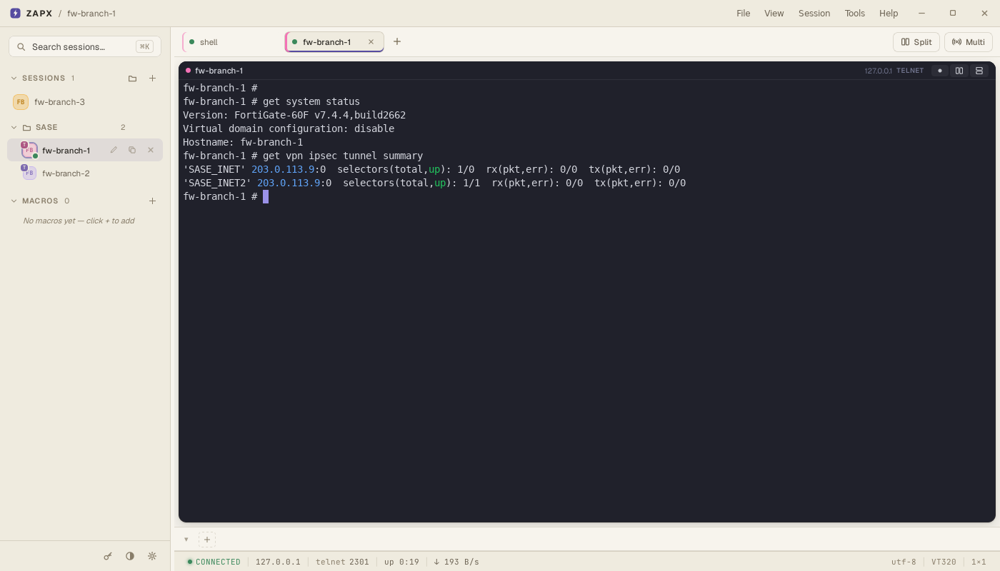
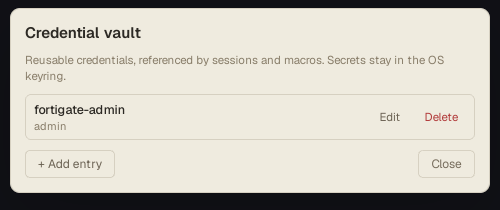
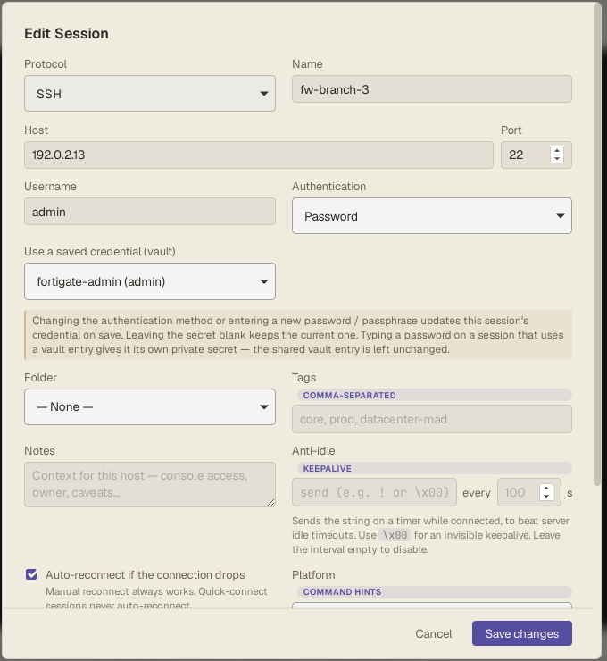
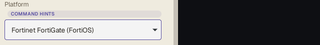
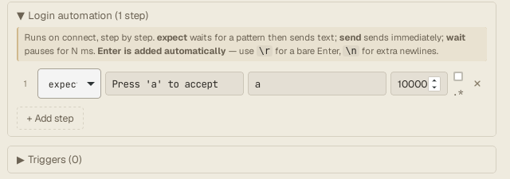

# 1. Getting started

[← Guide index](README.md) · Next: [2. Python scripts →](2-scripts.md)

In this part you install ZAPX, store a password once in the vault, save a
device that logs in on its own, and open it in a tab.

## Install

Download the installer for your system from the
[Releases page](https://github.com/CarlosTejeiro/zapx/releases) (latest
version):

| System | File |
|---|---|
| Windows | `ZAPX_<version>_x64-setup.exe` (or the `.msi`; `…_portable.exe` needs no install) |
| macOS | `ZAPX_<version>_aarch64.dmg` (Apple silicon) or `…_x64.dmg` (Intel) |
| Debian / Ubuntu | `ZAPX_<version>_amd64.deb` → `sudo apt install ./ZAPX_<version>_amd64.deb` |
| Fedora / RHEL | `ZAPX-<version>-1.x86_64.rpm` |
| Other Linux | `ZAPX_<version>_amd64.AppImage` |

Start **ZAPX** from your applications menu.

## The window

- **Left:** your saved devices (**SESSIONS**, in folders) and **MACROS**.
  Click a device to open it in a new tab.
- **Top:** one tab per open connection. The first tab, `shell`, is a terminal
  on your own computer.
- **Bottom:** one-click command buttons for the kind of device in the active tab
  (here, FortiGate commands), and the status bar.

## Step 1 — store the password in the vault

Type each password once, in the vault, and let sessions (and scripts) refer to
it by name. Click the **key** icon at the bottom left → **+ Add entry**:

- **Name:** a label you choose, e.g. `fortigate-admin` (it is *not* the user
  name).
- **Username:** e.g. `admin`.
- **Password:** the password.

The password goes to your operating system's keyring (Windows Credential
Manager, macOS Keychain, libsecret on Linux — or, where that isn't available,
an encrypted copy in ZAPX's database) and never appears again in ZAPX's
screens, exports or logs.

## Step 2 — save the device

Click **+** next to **SESSIONS** (or press `Ctrl+N`):

| Field | Example | Notes |
|---|---|---|
| Protocol | SSH | Telnet, serial and local shell are also available. |
| Name | `fw-branch-1` | How it appears in the sidebar, on the tab — and how scripts find it. |
| Host / Port | `192.0.2.11` / `22` | |
| Use a saved credential (vault) | `fortigate-admin (admin)` | Fills the user name; the password stays in the vault. |
| Folder | `SASE` | Create folders with the folder icon next to **SESSIONS**. Scripts can work on a whole folder. |

### Platform

Further down, **Platform** tells ZAPX what kind of device it is. It picks the
command buttons and autocomplete, and lets scripts recognise the device's
prompt. ZAPX usually detects it on connect; if it doesn't (in this guide's
Telnet lab it didn't), set it here — **Fortinet FortiGate (FortiOS)** for a
FortiGate:

### Login automation (optional)

Some devices show a banner you must answer before the prompt — for example a
disclaimer that says *Press 'a' to accept*. Open **Login automation** at the
bottom of the dialog and add a step: **expect** the banner text, **send** the
answer. It runs on every connect, for you and for scripts.

Click **Save**.

## Step 3 — connect

Click the device in the sidebar. A tab opens, ZAPX logs in, and you get the
prompt. Type a command to check, e.g. `get system status`.

That's all a script needs: **a saved session that logs in on its own.** Save
the other devices you want to automate the same way, in the same folder.

Next: [2. Python scripts →](2-scripts.md)
