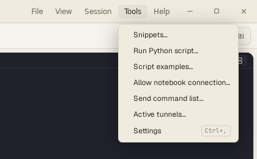
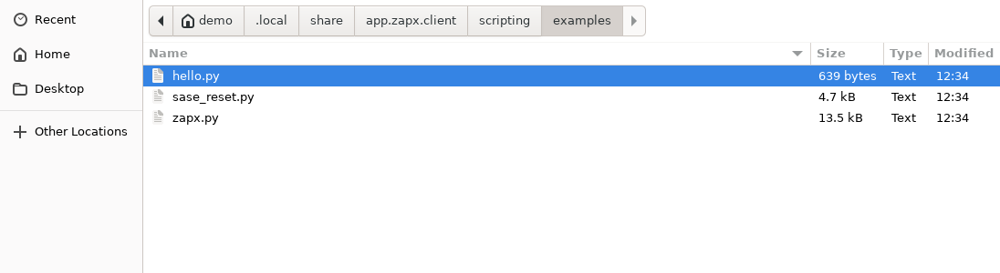
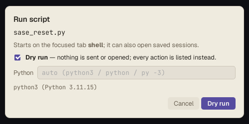
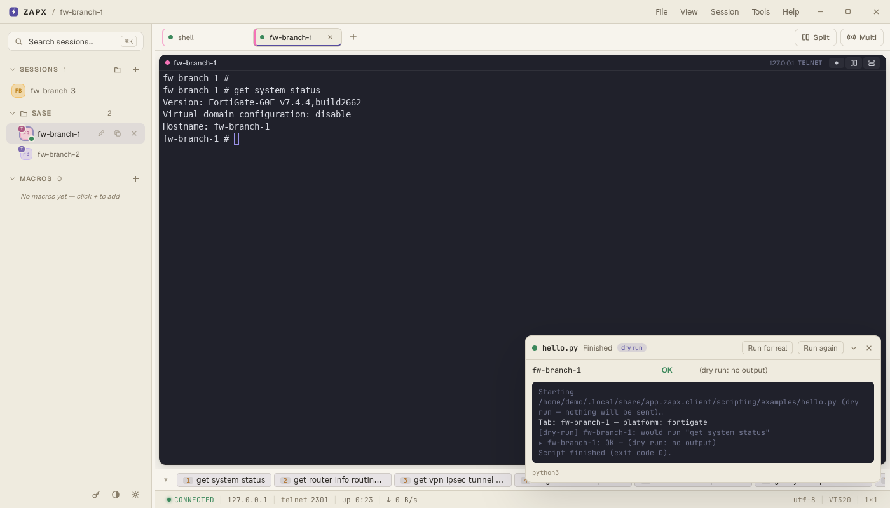
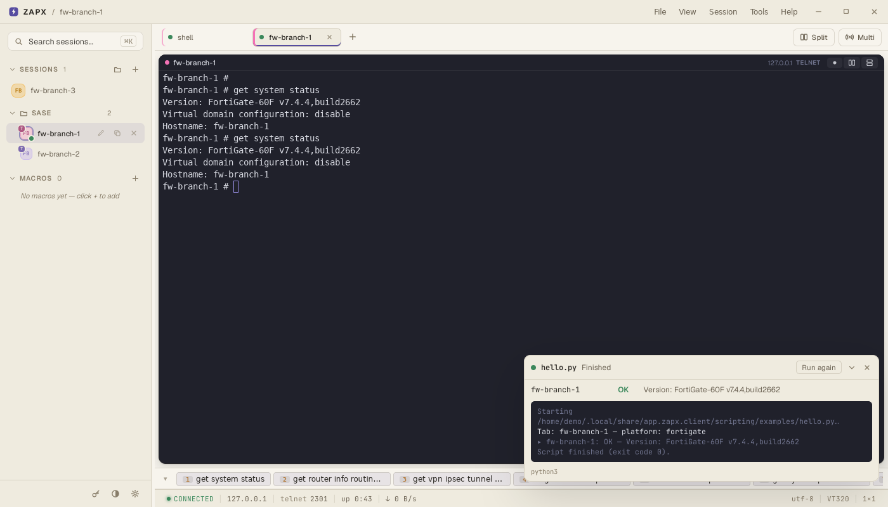
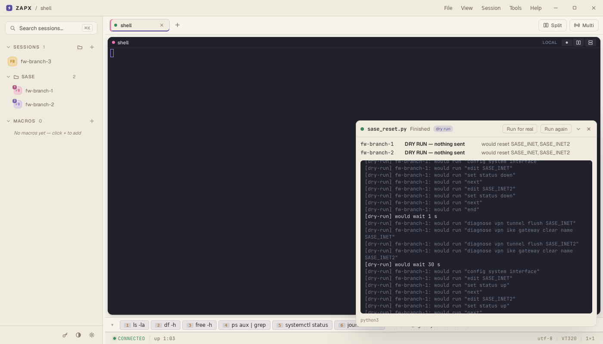
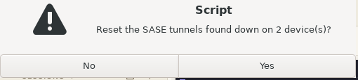
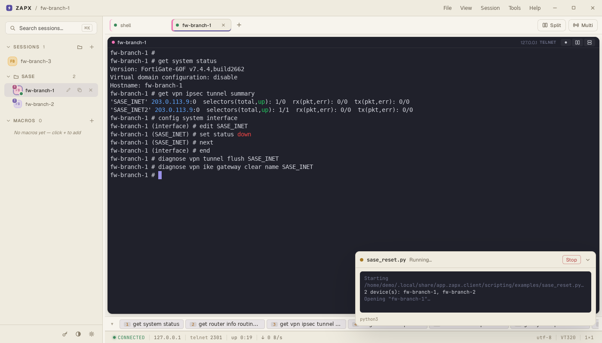
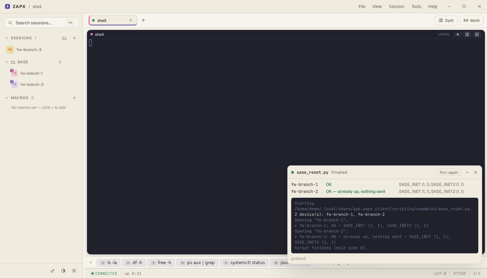

# 2. Python scripts

[← 1. Getting started](1-getting-started.md) · [Guide index](README.md) · Next: [3. Notebooks →](3-notebooks.md)

A ZAPX script is a normal Python file that tells ZAPX what to do on your
devices: open this one, run that command, look at the output, decide. ZAPX does
the typing in real tabs, so you see every command go out.

Use a script when a [macro](../README.md#5-macros) (a fixed list of
expect / send steps) isn't enough: when the next step depends on what the
device answered, or the same job runs on many devices.

## The two ready-made examples

**Tools → Script examples…** opens the examples folder. ZAPX fills it the first
time; your edits there are kept.



| File | What it does |
|---|---|
| `hello.py` | The smallest script: runs one command on the focused tab and reports it. |
| `sase_reset.py` | Finds the SASE IPsec tunnels that are down on a folder of FortiGates and resets only those. |
| `explore.ipynb` | A notebook — see [part 3](3-notebooks.md). |
| `zapx.py` | A copy of the `zapx` module, so your editor can autocomplete it. Don't edit it. |

## Your first script: `hello.py`

```python
import zapx

s = zapx.session()  # the tab that was focused when the script started
zapx.log(f"Tab: {s.name} — platform: {s.platform or 'unknown'}")

# run() types the command + Enter, waits for the prompt and returns the output.
out = s.run("get system status" if s.platform == "fortigate" else "uname -a")

first_line = out.splitlines()[0] if out else "(dry run: no output)"
zapx.report(s.name, "OK", first_line)
```

1. Open a device tab (part 1) and click in it, so it's the focused tab.
2. **Tools → Run Python script…** and pick `hello.py`:

   

3. The run dialog says which tab the script starts on and which Python it will
   use. **Dry run** is ticked:

   

   Click **Dry run**.

### What a dry run does

Nothing is typed and no tab is opened. The script runs normally, but every
action is listed as `[dry-run] … would …` in the panel at the bottom right:



`run()` returns an empty text in a dry run, so the script shows
`(dry run: no output)`. Mistakes in the Python code (a typo, a wrong name)
stop the script here with an error in the panel — before anything reaches a
device.

### Run it for real

Click **Run for real** in the panel. Now ZAPX types `get system status` in the
tab, waits for the prompt and hands the output to the script, which reports
the first line:



The **summary table** at the top of the panel holds what the script reported
with `zapx.report()`; the log below it holds its messages and errors.

## A real job: `sase_reset.py`

The problem: on some FortiGates, the SASE IPsec tunnels go down and need a
reset — bring the tunnel interface down, flush the tunnel, clear its IKE
gateway, wait, bring it back up, and check it comes back. By hand that is a
dozen commands per device, with waits, and easy to get wrong on the tenth
device.

### What the script does, per device

1. Opens the saved session (in a new tab).
2. Runs `get system status` and `get vpn ipsec tunnel summary`.
3. **Safety checks** — leaves the device untouched if VDOMs are enabled, or if
   a tunnel in `TUNNELS` doesn't exist (`edit` of a missing name would *create*
   it).
4. Works out which tunnels are down: a tunnel is down when not all its
   selectors are up (`selectors(total,up): 1/0`). **If none is down it sends
   nothing** and moves on.
5. For the tunnels that are down only:
   `config system interface` → `edit <tunnel>` → `set status down` → `end`,
   waits `AFTER_DOWN` s, `diagnose vpn tunnel flush <tunnel>`,
   `diagnose vpn ike gateway clear name <tunnel>`, waits `AFTER_FLUSH` s, then
   `set status up` — **always**, even if a step before it failed.
6. Re-runs the tunnel summary every `VERIFY_EVERY` s, for up to `VERIFY_FOR` s,
   until all selectors are up.
7. Reports `OK`, `NOT UP after … s`, `LEFT UNTOUCHED` or `FAILED` (one device
   failing doesn't stop the others) and closes the tab.

### Settings

Open `sase_reset.py` in any text editor. Only the top block needs changing:

```python
FOLDER = "SASE"           # saved sessions in this folder (and its sub-folders)…
DEVICES: list[str] = []   # …or list saved-session names here instead
TUNNELS = ("SASE_INET", "SASE_INET2")
AFTER_DOWN = 1            # seconds after `set status down`
AFTER_FLUSH = 30          # seconds after the flush / IKE clear
VERIFY_FOR = 60           # check the tunnels for up to this long…
VERIFY_EVERY = 5          # …every this many seconds
CLOSE_TABS = True         # close each device's tab when done
```

- Put your FortiGates in a folder and set `FOLDER`, **or** list them by name:
  `DEVICES = ["fw-branch-1", "fw-branch-7"]`.
- Set `TUNNELS` to your tunnel names.

### 1) Dry run first — always

Run it with **Dry run** ticked. The panel lists every command it *would* send,
per device:



In a dry run the script can't see real output, so it assumes every tunnel is
down and shows you the **longest** plan. Read it: right devices? right tunnel
names?

### 2) Run for real

Click **Run for real**. The script asks before touching anything:



Answer **Yes**. Each device opens in a tab and you watch the commands go out —
here on `fw-branch-1`, where `SASE_INET` was down (`selectors 1/0`):



The panel's **Stop** button ends the script at any time.

### 3) Read the result



- `fw-branch-1` — **OK**: the down tunnel was reset and both tunnels came back
  (`(1, 1)` = 1 selector, 1 up).
- `fw-branch-2` — **OK — already up, nothing sent**: both tunnels were up, so
  the script didn't touch it.

## Writing your own

Copy an example and change it. The calls you'll use most:

| Call | What it does |
|---|---|
| `zapx.open("name")` | Open a saved session in a new tab; returns it once logged in. |
| `zapx.session()` | The focused tab — call it first thing to get the one focused when you started the script. |
| `zapx.sessions(folder="SASE")` | Names of the saved sessions in a folder. |
| `s.run("command")` | Type it, wait for the prompt, return the output. |
| `s.poll("command", until=…, every=5, max=60)` | Repeat a command until a condition holds. |
| `s.send_secret("fortigate-admin.Password")` | Type a vault password into the tab (your code never sees it). |
| `zapx.confirm("Go ahead?")` | Ask yes / no in ZAPX. |
| `zapx.report(device, status, detail)` | Add a row to the summary table. |
| `zapx.log("text")` | Write a line in the panel. |

The full list, and how `run()` decides a command has finished, is in the
[scripting reference](../scripting.md#api).

**Good habits**

- Dry run every new or changed script first.
- Check before you change: read the state, decide, and send nothing when there
  is nothing to fix.
- Put the undo in a `finally:` block, like `sase_reset.py` does with
  `set status up`.
- Never write passwords in a script — use the vault and `send_secret()`, or let
  the saved session log in.

To try commands one at a time and see real output while you write the script,
use a notebook: [3. Notebooks →](3-notebooks.md)
