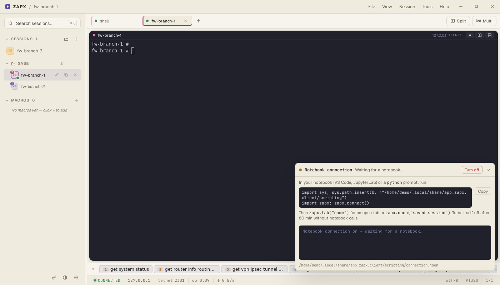
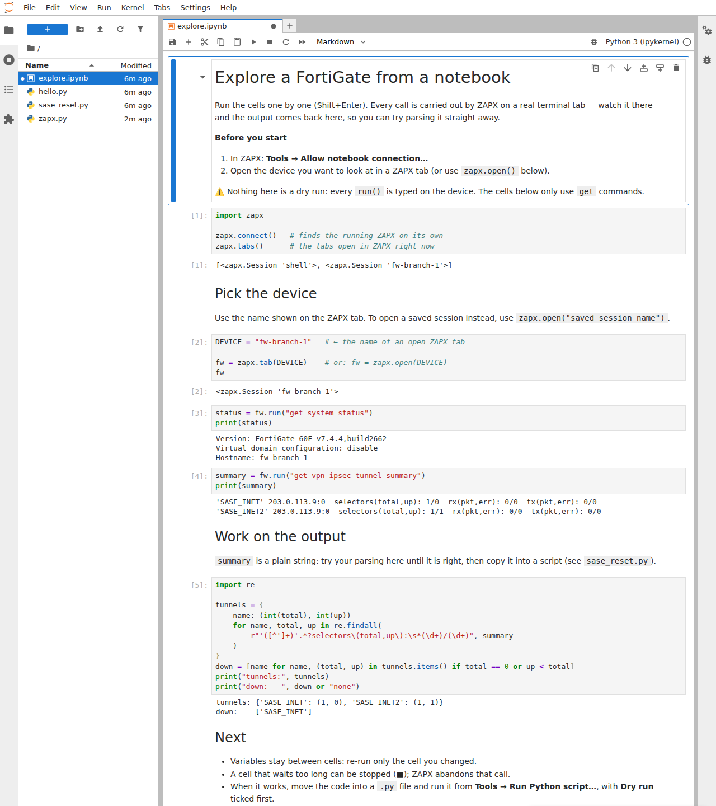
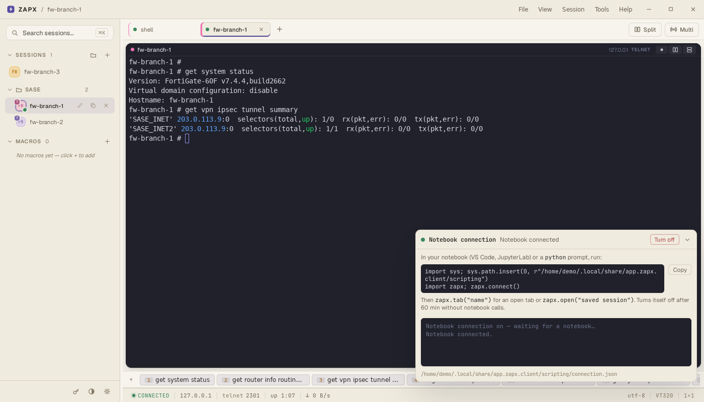

# 3. Notebooks

[← 2. Python scripts](2-scripts.md) · [Guide index](README.md)

A script runs from top to bottom. While you're *writing* one you usually want
the opposite: run one command, look at what the device really prints, write the
next bit against that output, try again. That's what a notebook is for.

A notebook (`.ipynb`) is a page of **cells**. You run one cell at a time
(`Shift+Enter`); its output appears under it, and variables stay alive for the
next cells. ZAPX lets a notebook drive its tabs with the same `zapx` module as
scripts.

> ⚠️ **A notebook is never a dry run.** Every `run()` is typed on the device.
> Explore with read-only commands (`get …`, `show …`) and keep changes for a
> script you've dry-run.

## One-time setup

You need one of these:

- **VS Code** with the **Python** and **Jupyter** extensions (Microsoft). The
  first time you run a cell it asks which Python to use and offers to install
  `ipykernel` in it — accept.
- **JupyterLab** in a browser: `pip install jupyterlab`, then run
  `jupyter lab` from the examples folder.

## Step 1 — let notebooks connect

In ZAPX: **Tools → Allow notebook connection…**. The panel shows *Waiting for a
notebook…* and the lines a notebook needs:

The connection is off by default, local to your computer only, and turns
itself off after 60 minutes without notebook activity or when ZAPX closes.
**Turn off** in the panel ends it any time.

## Step 2 — open the example notebook

**Tools → Script examples…** and open `explore.ipynb` in VS Code or
JupyterLab. Opened from that folder, `import zapx` finds the module next to it.
(A notebook saved anywhere else: first paste the `sys.path.insert(…)` line the
ZAPX panel shows — **Copy** puts it on the clipboard.)

Open the device you want to look at in a ZAPX tab, and set `DEVICE` in the
notebook to the name on that tab.

## Step 3 — run it cell by cell

What each cell does:

1. `zapx.connect()` connects to ZAPX (the panel turns to *Notebook connected*);
   `zapx.tabs()` lists what is open in ZAPX.
2. `fw = zapx.tab(DEVICE)` picks the open tab by name —
   or `zapx.open("saved session")` opens one.
3. `fw.run("get system status")` — the command is typed in ZAPX and its output
   comes back to the notebook.
4. The same for `get vpn ipsec tunnel summary`, kept in `summary`.
5. Plain Python on `summary`: a regular expression pulls out each tunnel's
   selectors and lists the tunnels that are down — `SASE_INET` here.

Meanwhile, in ZAPX, you see each command in the tab:

## Tips

- **Re-run only what changed.** Variables stay between cells: fix your parsing
  in cell 5 and re-run just that cell — no need to ask the device again.
- **Stop a cell** with ■ if it waits too long. ZAPX abandons that call and the
  next cell starts clean.
- **One notebook at a time.** A second notebook's `connect()` is refused while
  one is connected; restart or close the first notebook's kernel.
- **After Turn off / Turn on**, the next call fails once with *"ZAPX closed the
  connection … run the cell again to reconnect"*. Run it again.

## From notebook to script

When the cells do what you want:

1. Copy them into a new `.py` file in the examples folder.
2. Replace `zapx.tab(DEVICE)` with `zapx.open(name)` in a loop over
   `zapx.sessions(folder=…)` if it should run on many devices.
3. Remove `zapx.connect()` — scripts started from ZAPX are connected already.
4. Add `zapx.report(…)` lines for the summary table.
5. **Tools → Run Python script…**, with **Dry run** first.

`sase_reset.py` is exactly that: the parsing from `explore.ipynb`, plus the
reset, run on a folder of devices.

[← 2. Python scripts](2-scripts.md) · [Guide index](README.md) · [Scripting reference](../scripting.md)
